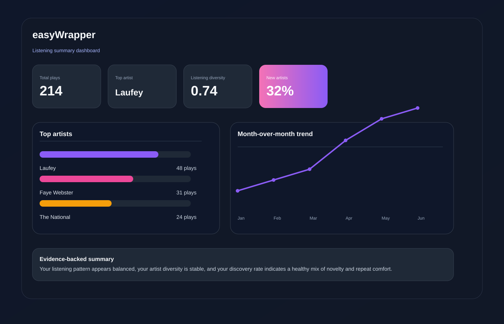

# easyWrapper



A small, personal wrapped-style analytics project for listening-history CSV exports. It turns a raw music export into a readable dashboard, a PDF report, and a few defensible stats without requiring a notebook workflow or an expensive API budget.

This project is designed to be easy to run from a fresh clone: drop in your CSV, choose a timezone, and get a summary in minutes.

## Why this project

- It is meant for personal listening-history exports, not for a hosted product.
- It accepts both headered and headerless CSVs.
- It keeps the analysis transparent and explainable.
- It avoids unsupported claims like a literal "melodic complexity" score.
- It focuses on honest measures such as listening diversity, discovery rate, and month-over-month shifts.

## How to get your export

You can usually export a CSV from your music service or listening history provider in one of these ways:

- Spotify: Account > Data and privacy > Download your data
- Apple Music: use the export flow available through your account history or app data access
- Last.fm or other music services: export your scrobbles/history CSV
- If you use an app or service that does not support direct CSV export, you may need to request a history export or use a personal tool that exports your stream logs

The expected columns are usually one of these:

- `artist, album, track, timestamp`
- or a headered version with the same names (`artist`, `album`, `track`, `timestamp` / `listened_at`)

The tool will skip malformed rows and duplicate entries, but it still helps to clean the export before running.

## Quick start

1. Clone the repo and create a virtual environment
a. Python 3.10+ is recommended.

```bash
python -m venv .venv
# Windows
.venv\Scripts\activate
# macOS / Linux
source .venv/bin/activate
```

2. Install the package and its dependencies

```bash
pip install -e .
```

3. Run the CLI against a CSV file

```bash
easywrapper data/sample_listening_history.csv --html --open-browser
```

Or generate the PDF version:

```bash
easywrapper data/sample_listening_history.csv --output wrapped_report.pdf
```

If your export timestamps are naive, set the timezone explicitly:

```bash
easywrapper data/sample_listening_history.csv --timezone America/New_York
```

## Project structure

- `main.py` – CLI entry point
- `src/easywrapper/loader.py` – CSV parsing, deduping, timezone handling, summary stats
- `src/easywrapper/html_report.py` – browser-based dashboard
- `src/easywrapper/report_generator.py` – PDF report generation
- `src/easywrapper/audio_enrichment.py` – offline and optional enrichment adapters
- `src/easywrapper/spotify_client.py` – optional Spotify enrichment
- `src/easywrapper/models.py` – data model
- `data/sample_listening_history.csv` – tiny sample dataset for quick-start testing

## Offline by default

The app is intentionally safe to run without live requests. It defaults to a local/offline flow unless you explicitly opt into an enrichment provider.

If you want to use private credentials, add them to a local `.env` file in the project root and provide the provider explicitly.

## What the report includes

- total plays and unique artists
- top artists and top tracks
- listening diversity score (normalized Shannon entropy of your artist distribution)
- discovery rate by month (new vs repeat artists)
- month-by-month trend data
- most active hour/day and listening window
- optional audio-feature cards when metadata is available

## Stats with a defensible basis

This project tries to avoid pseudo-scientific labels and instead uses transparent math:

- Listening diversity: Shannon entropy over your artist distribution, normalized to a 0–1 scale
- Discovery rate: new artists vs repeat artists by month
- Time-of-day: explicit timezone-aware calculations that prevent drift from local timezone assumptions
- Artist normalization: strips `feat.` and case differences so counts do not split the same artist across variants

## Research-backed additions you could add next

These are the most sensible extensions to keep the idea grounded instead of turning it into vague personality profiling:

- Reminiscence bump: compare release years against a user’s age range
- Taste diversity and drift: month-to-month Jensen-Shannon divergence
- Familiarity curve: track replays per song over time
- Time-of-day and mood regulation: compare late-night vs daytime listening habits
- Discovery versus comfort ratio: new artists versus repeat artists over time

Each of these should come with a short Methods and limits section, not just a polished headline.

## License

This project is licensed under the MIT License. See `LICENSE` for details.
